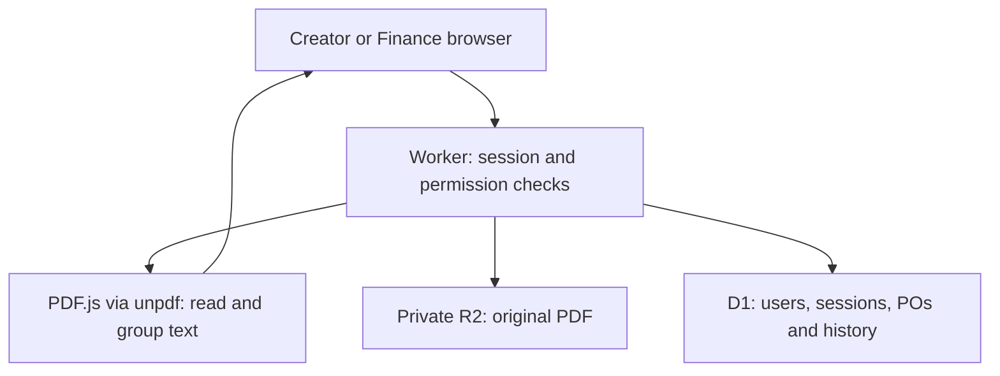

# PEP Order Desk
**Veeral Patidar · 22JE1065 · PEP Brands FDE assignment**

[Open the live app](https://pep-po-desk-vp26.dependablemango64.chatgpt.site) · [Database health](https://pep-po-desk-vp26.dependablemango64.chatgpt.site/health)

Operations uploads a purchase order, reviews extracted values against the original and submits it. Finance can approve it or return it with a reason. The PO page keeps the original PDF and a server-timestamped history of each decision.

### Reviewer sign-in

Use the matching password in **M2-demo-logins.txt**, supplied separately with the submission. All four demo accounts signed in successfully on the live site on 28 November 2026.

| Username | What to try |
|---|---|
| creator1 | Open PO-2026-001 for the five-row extraction or PO-2026-003 for the blocked mismatch. |
| creator2 | Create a separate draft and confirm the creator list contains only this account’s POs. |
| approver1 | Use the Finance queue to reject another creator’s submitted order with a reason. After correction and resubmission, approve it. |
| lead1 | Use both creator and approver views. The server refuses decisions on this user’s own POs. |

For a fresh approval walkthrough, change the draft’s number to a new demo number before saving. The original printed number remains in the extraction snapshot. To demonstrate duplicate detection instead, leave the printed number unchanged.

### Architecture and upload journey



File selection sends the PDF to the authenticated preview endpoint. The Worker checks its signature and 5 MB limit, reads positioned text and returns editable fields and warnings. Saving a draft validates its values, processes the original server-side, writes the file to a random R2 key, and inserts the PO with its initial extraction snapshot into D1. The response returns the new PO ID. Opening the PDF goes through the Worker’s PO access check.

### Document reading and validation

**Level 1** extracts the number, date, vendor and printed total. **Level 2** extracts SKU, description, quantity, unit price and printed amount. Text spans are grouped by page position. Recognizable header labels and table structure determine what to prefill. Unusable text gives a manual form; a partial header or uncertain table gives a warning. The saved PO shows its extraction method. The parser handles day-first dates, common currency prefixes, Indian grouping and wrapped descriptions in the supplied templates.

Amounts are stored in integer paise. Submission rechecks required fields, positive quantities and prices, each multiplication, and the sum of the printed line amounts against the printed document total. Exactly ₹1 difference is accepted. An empty table shows “Line items not checked.” A database unique constraint on the normalized PO number covers all owners and statuses.

| Live browser test, 28 November 2026 | Observed result |
|---|---|
| Clean digital PO | Five editable rows, including MC-027’s wrapped description; ₹2,54,200. Saved as a draft and reopened with text_layer and a byte-identical original. |
| Mismatched total | Printed ₹1,42,500; calculated ₹1,24,500. Draft saved; submission returned 400 with the ₹18,000 difference. |
| Signed resend | Same PO number; save returned 409 with a generic duplicate message. |
| Garbled text | Manual-entry message, empty header and zero prefilled rows. |

### Permissions and operations

- **worker/auth.js** checks bcrypt password hashes, issues an eight-hour HttpOnly session cookie, resolves roles from D1 and revokes the session on logout. Missing or expired sessions return 401.
- **worker/orders.js** restricts creator reads and writes by owner. Another creator’s PO or PDF returns 404 to avoid disclosing its contents. An unauthorized decision, including self-approval or self-rejection, returns 403. An invalid state, stale revision or duplicate number returns 409.
- Only the owner edits DRAFT or REJECTED. Finance decides SUBMITTED POs. APPROVED is final. A D1 batch pairs the revision-checked transition with one history entry for its successful operation. Entries have no edit/delete endpoint. In the live permission test two concurrent approvals produced one 200, one 409 and one audit entry.
- **GET /health** probes D1 with SELECT 1 and returns 503 on failure. For a failed approval, check health, the HTTP response, role, owner, status and revision; then correlate the request time with the host’s logs.

### Local setup

Use Node 24 and npm from the repository root. For a fresh local database, apply the migrations once in the order below. Existing Milestone 2 local databases need only the second migration. The local Wrangler configuration uses local D1 and R2.

```bash
npm ci
npm test
npm run build
npx wrangler@4 d1 execute DB --local --config wrangler.local.json --file drizzle/0000_sturdy_mister_fear.sql
npx wrangler@4 d1 execute DB --local --config wrangler.local.json --file drizzle/0001_amazing_alex_power.sql
npx wrangler@4 dev --local --config wrangler.local.json
```

Open the localhost URL printed by Wrangler. For all original sample tests, run `SAMPLE_PDF_DIR="$HOME/Downloads" npm test` when all four PDFs are in Downloads. With all inputs present, the final run passed 12 tests and the build. The Worker uses runtime DB and BUCKET bindings; their names appear in .env.example.

### Decisions and limits

The app uses JavaScript, a Worker ES module, D1/SQLite and private R2 storage. The build started from the Sites Worker build convention; the UI and workflow are application code. esbuild bundles the Worker, Drizzle manages SQL migrations, and unpdf/PDF.js handles text-layer parsing without sending supplier files to an external model. Unknown layouts, rotated scans and password-protected files may require manual entry. Future OCR would render unreadable pages to images, recognize their text, then reuse the same review form and numerical checks. An interrupted cross-service save can also leave an unreferenced R2 object; a reconciliation job could clean these up.
